# Helploom

Helploom is an AI help desk for businesses. A company uploads its support documents
(policies, handbooks, FAQs in PDF, DOCX, Markdown, TXT or HTML) and gets a chat
widget for its website that answers customer questions from those documents, cites
the passages it used, streams the answer in real time, and hands the conversation to
a person when the documents do not cover the question.

Staff work in a dashboard: they manage the document library, test the assistant in a
playground, read every conversation with its citations and ratings, pick up handoff
tickets, watch support reports, and manage the team, the plan and the widget.

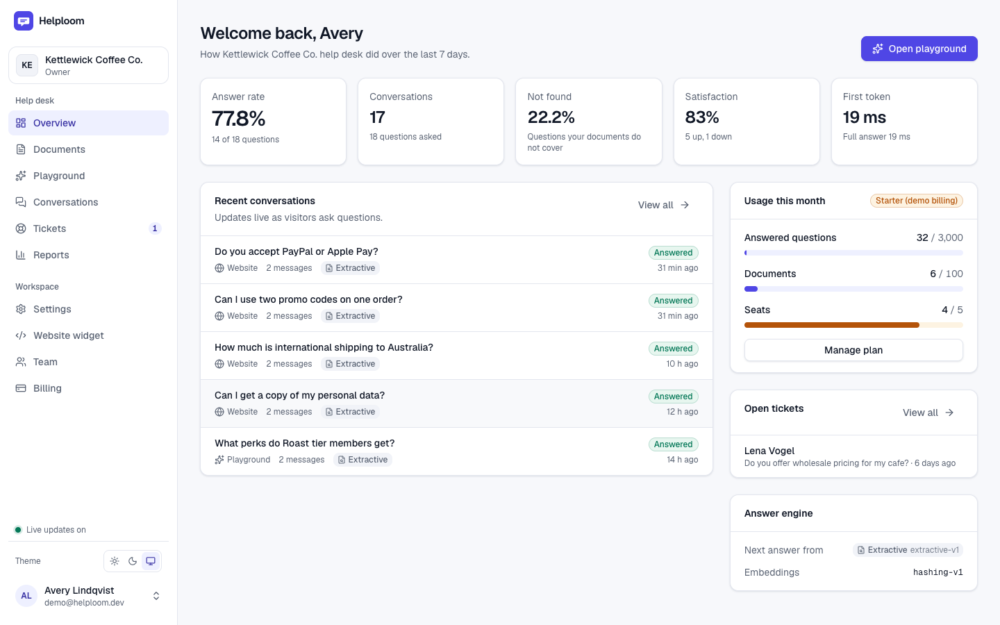

It runs fully offline on a laptop with nothing but PostgreSQL, uv and Node: a local
hashing embedder and an extractive answer mode keep every feature working without a
model. Point it at Ollama or the Claude API and the same pipeline produces written
answers.

## Contents

- [Screenshots](#screenshots)
- [Features](#features)
- [Architecture](#architecture)
- [Tech stack](#tech-stack)
- [Quick start](#quick-start)
- [Answer providers: Ollama and Claude](#answer-providers-ollama-and-claude)
- [Configuration](#configuration)
- [How retrieval works](#how-retrieval-works)
- [Evaluation](#evaluation)
- [Testing](#testing)
- [Project structure](#project-structure)
- [Security](#security)
- [Roadmap](#roadmap)

## Screenshots

| | |
| --- | --- |
| 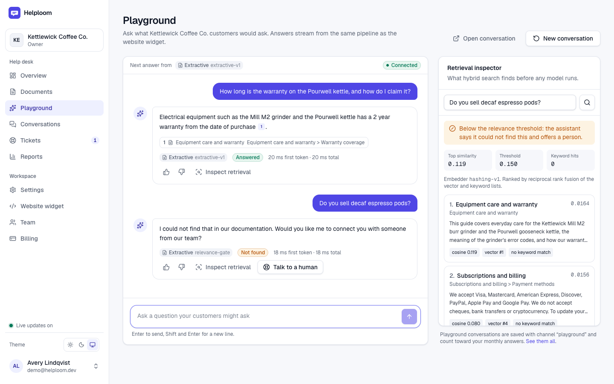 | 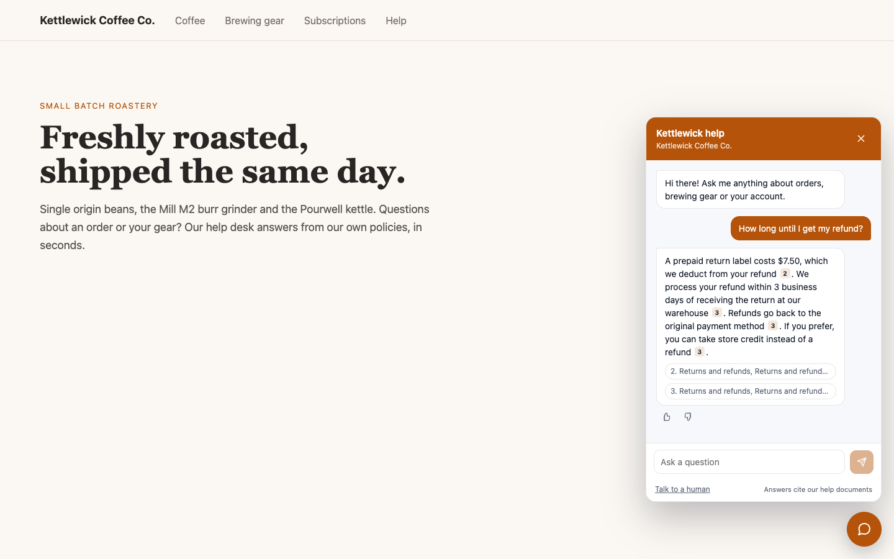 |
| **Playground.** A cited answer, then an out of scope question that gets the honest "not found" answer and a handoff offer. The retrieval inspector shows what hybrid search found and why. | **Website widget** on a plain storefront page served from another origin, streaming an answer with citation chips. |
| 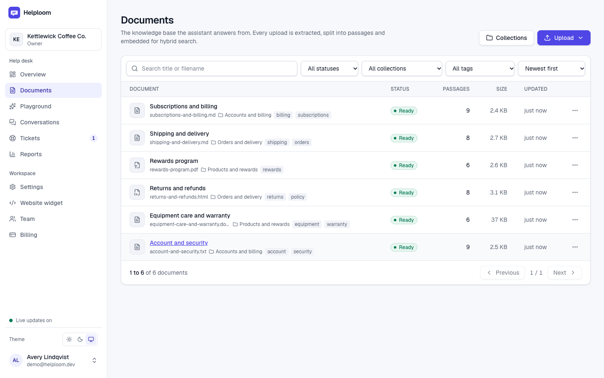 | 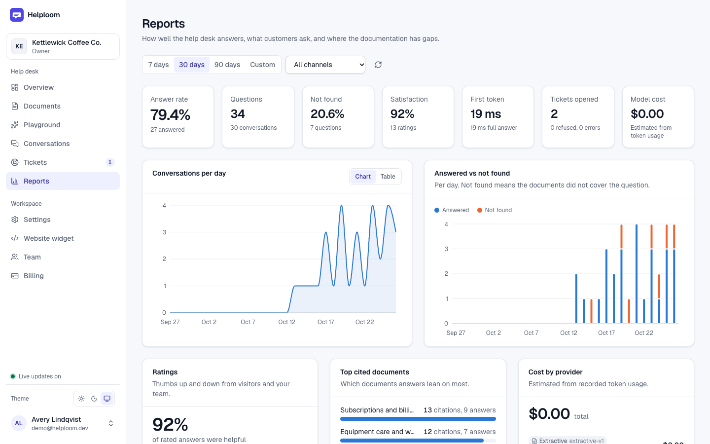 |
| **Documents.** Six formats, live status over a websocket, passages, collections and tags. | **Reports.** Answer rate, not found rate, satisfaction, daily volume, top cited documents and cost by provider. |
| 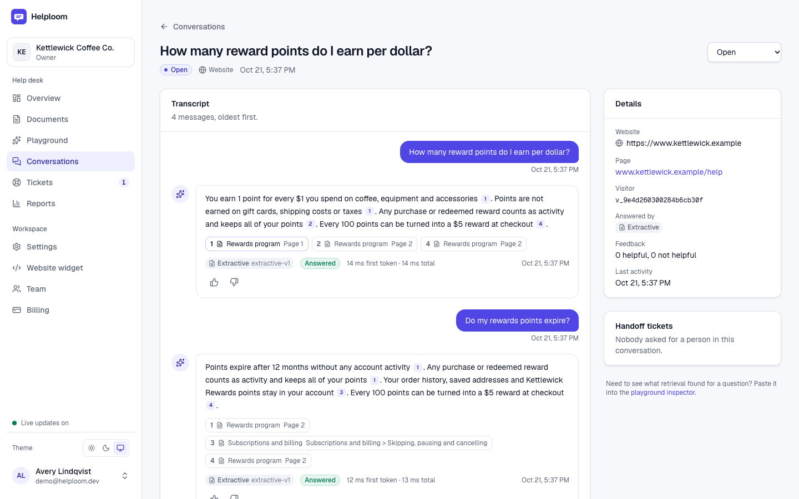 | 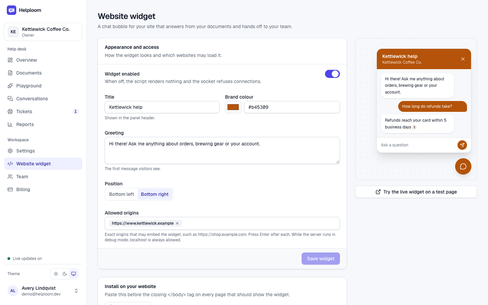 |
| **Conversation detail.** Every answer with its citations, provider, model and latency. | **Widget settings.** Branding, greeting, allowed origins, live preview and the embed snippet. |
| 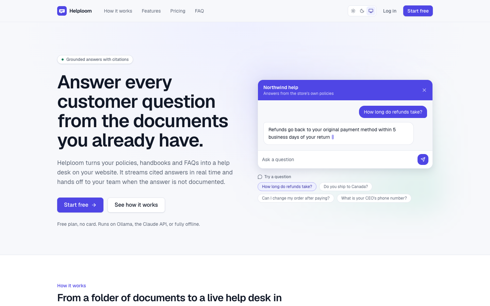 | 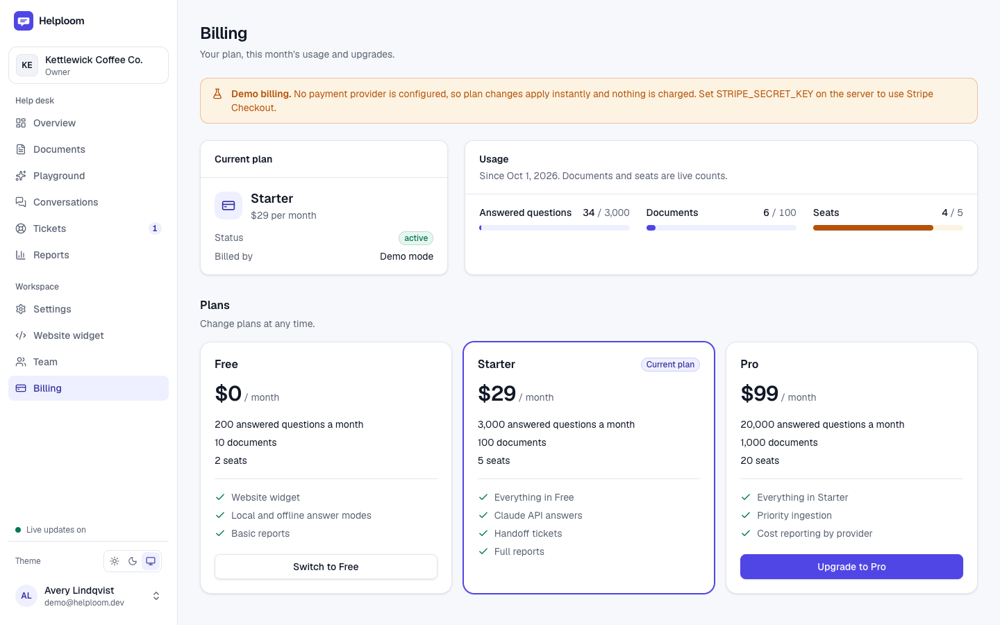 |
| **Landing page** with pricing from the plans API. | **Billing** in demo mode: plans switch instantly; Stripe Checkout when a key is set. |

The screenshots come from the seeded demo workspace (`make seed`) with the offline
providers, so the answers are extractive: real sentences from the documents with
their citations.

## Features

**Documents**
- Multi-file drag and drop upload with per file progress. Size limit, type sniffing
  from the bytes (the extension must agree), SHA-256 duplicate detection and plan
  limits are checked before anything is stored.
- Ingestion pipeline with a live status (queued, processing, ready, or failed with a
  readable reason) pushed over the dashboard socket.
- Extractors for PDF (page numbers kept for citations), DOCX (headings, lists,
  tables), Markdown, TXT and HTML. Heading aware chunking.
- Text and passage preview, re-index, delete, tags and collections.

**Answers**
- Hybrid retrieval: pgvector cosine search plus PostgreSQL full-text search, fused
  with reciprocal rank fusion and diversified with maximal marginal relevance.
- A relevance gate before any model runs: below the threshold the answer is "I could
  not find that in our documentation" with an offer to talk to a person, which creates
  a handoff ticket.
- Prompt injection defences: rules in a stable system prompt, passages in delimited
  blocks a document cannot close, and an explicit instruction to ignore instructions
  found in documents or customer text.
- Citations parsed back into structured references (document, location, snippet).
- Three providers behind one interface: Ollama, Claude through the official SDK, and
  an offline extractive mode. The dashboard shows which one answered each message.

**Website widget**
- One script tag. Renders inside a Shadow DOM so the host page's CSS cannot leak in.
- Public site key, per workspace origin allow list checked on the config endpoint and
  the socket handshake, per IP connection and message rate limits.
- Streaming answers with citation chips, thumbs up and down, "Talk to a human",
  conversation resume after a reload, theme colour, title and greeting from settings.

**Dashboard**
- Playground over a websocket, with cancel, ratings, handoff and a retrieval inspector.
- Conversation history with filters (channel, status, answer type, rating, provider,
  ticket, date range, search).
- Handoff tickets with status, assignee and notes.
- Reports: conversations per day, answered vs not found, ratings, top questions, top
  cited documents, unanswered questions (content gaps), tokens and cost by provider.
- Team: owner, admin and agent roles, email invitations, last owner protection.
- Billing: Free, Starter and Pro plans with monthly message, document and seat limits,
  metered and enforced with friendly errors. Stripe Checkout, portal and webhooks
  when `STRIPE_SECRET_KEY` is set; a clearly labelled demo mode otherwise.
- Settings: workspace name, assistant tone, widget appearance and origins, and a
  provider status panel.
- Light and dark themes, responsive down to phone width.

## Architecture

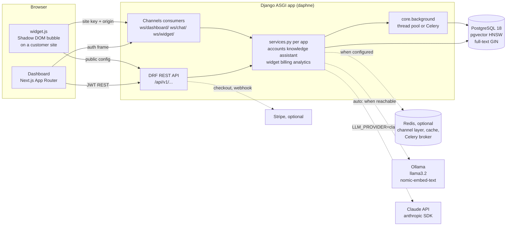

A question travels like this:

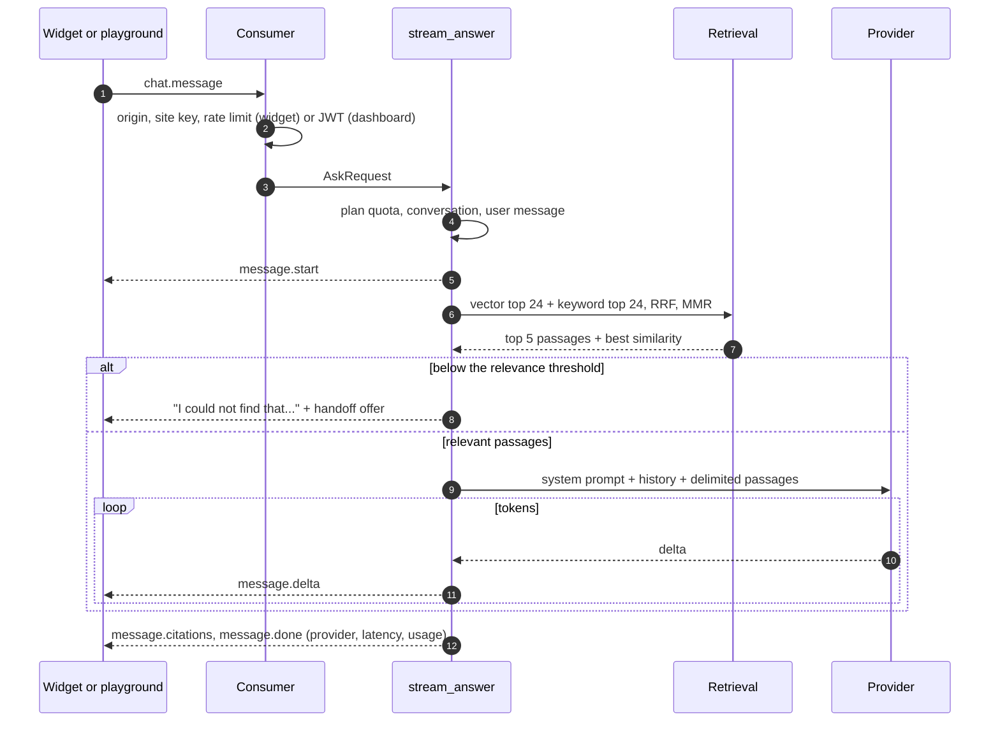

Design choices, briefly. The full reasoning, with the alternatives weighed, is in
[docs/DESIGN.md](docs/DESIGN.md).

- **One database.** PostgreSQL holds the relational data, the vectors (pgvector) and
  the keyword index (full-text search). Tests run against the same PostgreSQL, so they
  exercise the queries production runs. No SQLite anywhere.
- **One process type for HTTP and websockets.** Django under daphne; Channels routes
  each app's sockets. Without Redis the channel layer and cache are in memory, and
  without a Celery broker ingestion runs in a thread pool, so local development needs
  no extra services.
- **Business logic in `services.py`.** Views, consumers, Celery tasks and management
  commands are thin and call the same service functions, which know nothing about
  HTTP.
- **Tenant isolation in the query layer.** Every tenant row carries its organisation;
  `OrganizationScopedMixin` filters every view's queryset, both search queries put
  `organization_id` in SQL, and another tenant's ids return 404.
- **External services behind interfaces** (providers, embedders, the Stripe client)
  with offline implementations, so no test touches the network.

## Tech stack

| Layer | Technology |
| --- | --- |
| Backend | Python 3.13 with uv, Django 5.2 LTS, Django REST Framework, Simple JWT, Channels and daphne, django-cors-headers |
| Data | PostgreSQL 18, pgvector 0.8 (HNSW, cosine), full-text search (generated `tsvector`, GIN) |
| AI | Ollama (llama3.2, nomic-embed-text) over httpx, the official `anthropic` SDK, a local hashing embedder, numpy |
| Documents | pypdf, python-docx, the standard library HTML parser |
| Background and real time | Thread pool or Celery; in-memory or Redis channel layer |
| Frontend | Next.js 16 (App Router), React 19, TypeScript strict, Tailwind CSS 4, recharts, hand-built components |
| Widget | Framework free TypeScript bundled by esbuild (about 9 KB gzipped) |
| Quality | pytest and pytest-django, ruff, mypy with the Django and DRF plugins, ESLint |
| Deployment | docker-compose: pgvector, Redis, backend, Celery worker, frontend, Ollama |

## Quick start

Requirements: PostgreSQL 18 with pgvector, [uv](https://docs.astral.sh/uv/) and
Node.js 20.9 or newer. Ollama and an Anthropic key are optional.

**1. PostgreSQL** (macOS with Homebrew)

```bash
brew install postgresql@18 pgvector
brew services start postgresql@18
createdb helploom
```

The first migration runs `CREATE EXTENSION vector`, so a fresh database and the test
database (`test_helploom`) get pgvector automatically.

**2. Backend** on http://localhost:8000

```bash
cd backend
cp .env.example .env            # working local defaults; DATABASE_URL=postgres://localhost:5432/helploom
uv sync
uv run python manage.py migrate
uv run python manage.py seed_demo
uv run python manage.py runserver 127.0.0.1:8000    # daphne: HTTP and websockets
```

`seed_demo` creates `demo@helploom.dev` with a random password it prints, the
Kettlewick Coffee Co. workspace, the six sample documents from `backend/evals/kb/`
indexed through the real pipeline, a small team with a pending invitation, and 29
example conversations (32 questions, two handoff tickets) answered by the real answer
pipeline and spread over the last two weeks. Run it again with
`--reset` to rebuild, or pass `--password` to choose one.

**3. Frontend** on http://localhost:3000

```bash
cd frontend
npm install
npm run dev
```

Sign in at http://localhost:3000/login with the printed demo credentials, or create
a new workspace at http://localhost:3000/signup.

**Or with make**, from the repository root:

```bash
make install     # creates backend/.env with a random SECRET_KEY, uv sync, npm install
make migrate
make seed        # prints the demo sign in details
make dev         # backend on :8000 and frontend on :3000; Ctrl-C stops both
make help        # every command
```

**Try the widget.** Open http://localhost:3000/widget-demo, paste the site key from
Website widget settings (also printed by `seed_demo`), and chat. To embed it on any
page, paste the snippet from the same settings page:

```html
<script src="http://localhost:3000/widget.js" data-site-key="hlp_pk_..."
        data-api-url="http://localhost:8000" data-ws-url="ws://localhost:8000" defer></script>
```

While the server runs with `DEBUG=true`, any `localhost` origin is allowed; otherwise
add the page's origin to the allowed origins.

**Production shape.** `docker-compose.yml` runs PostgreSQL with pgvector, Redis, a
migration job, the ASGI backend, a Celery worker, the frontend and Ollama (with a job
that pulls both models). Copy `.env.example` to `.env`, set `SECRET_KEY` and
`POSTGRES_PASSWORD`, then `docker compose up -d --build`.

## Answer providers: Ollama and Claude

With the defaults (`LLM_PROVIDER=auto`, `EMBEDDER=auto`) Helploom uses Ollama when it
is reachable and has the models pulled, and the offline modes otherwise. The provider
status panel in Settings shows what is configured, what is reachable and what the next
answer will use.

**Ollama**

```bash
brew install ollama
brew services start ollama          # or: ollama serve
ollama pull llama3.2
ollama pull nomic-embed-text
```

Restart the backend. New answers come from llama3.2, streamed over NDJSON from
`/api/chat`. Documents indexed with the hashing embedder keep working (search uses
the embedder that indexed them) until you move them to nomic-embed-text:

```bash
cd backend && uv run python manage.py reembed
```

**Claude**

```bash
# backend/.env
LLM_PROVIDER=claude
ANTHROPIC_API_KEY=sk-ant-...
```

Claude is called through the official Python SDK with streaming, a cached system
prompt, low effort for chat latency and a server side refusal fallback:

```python
client = anthropic.AsyncAnthropic()  # reads ANTHROPIC_API_KEY from the environment
async with client.beta.messages.stream(
    model=settings.CLAUDE_MODEL,  # "claude-opus-5-5"
    max_tokens=4096,
    system=[{"type": "text", "text": SYSTEM_PROMPT, "cache_control": {"type": "ephemeral"}}],
    messages=history_plus_question_with_passages,
    output_config={"effort": "low"},
    betas=["server-side-fallback-2026-06-01"],
    fallbacks=[{"model": "claude-opus-4-8"}],
) as stream:
    async for text in stream.text_stream:
        ...  # forwarded to the websocket as message.delta
    final = await stream.get_final_message()
```

`final.stop_reason` is checked before the content is trusted: `refusal` sends a
polite fallback answer, `max_tokens` marks the answer truncated. Authentication, rate
limit, status and connection errors are caught most specific first and fall back to
the extractive provider with a logged warning, so a customer always gets an answer.
Input, output and cache read tokens are stored per message and priced in the cost
report. No sampling or thinking parameters are sent, and there is no assistant
prefill.

**Offline**

`LLM_PROVIDER=extractive` and `EMBEDDER=hashing` need nothing but PostgreSQL. The
extractive provider picks the question's best supporting sentences from the top
passages, keeps them in document order and cites each one, in the same `[n]` format
the models use, so citations and the UI behave identically.

## Configuration

Every backend variable is documented in [`backend/.env.example`](backend/.env.example)
and every frontend variable in [`frontend/.env.example`](frontend/.env.example). The
ones you are most likely to change:

| Variable | Default | Purpose |
| --- | --- | --- |
| `DATABASE_URL` | `postgres://localhost:5432/helploom` | PostgreSQL with pgvector available |
| `DEBUG` | `true` locally | `false` switches on production hardening and requires a real `SECRET_KEY` |
| `SECRET_KEY` | random in `.env` | Django and JWT signing |
| `LLM_PROVIDER` | `auto` | `auto`, `ollama`, `claude` or `extractive` |
| `EMBEDDER` | `auto` | `auto`, `ollama` or `hashing` |
| `OLLAMA_URL`, `OLLAMA_MODEL`, `OLLAMA_EMBED_MODEL` | `http://localhost:11434`, `llama3.2`, `nomic-embed-text` | Local models |
| `ANTHROPIC_API_KEY` | empty | Read by the SDK from the environment; never stored or returned |
| `CLAUDE_MODEL`, `CLAUDE_CHAT_EFFORT` | `claude-opus-5-5`, `low` | Claude model and effort for the chat route |
| `RELEVANCE_THRESHOLD` | empty | Empty uses each embedder's calibrated default (hashing 0.15) |
| `RETRIEVAL_TOP_K`, `RETRIEVAL_CANDIDATES`, `RRF_K` | `5`, `24`, `60` | Passages sent to the model, candidates per search side, fusion constant |
| `RETRIEVAL_MMR`, `RETRIEVAL_MMR_LAMBDA` | `true`, `0.7` | Diversity re-ranking |
| `CHUNK_TARGET_TOKENS`, `CHUNK_OVERLAP_TOKENS` | `350`, `50` | Chunk size and overlap |
| `MAX_UPLOAD_MB`, `MAX_FILES_PER_UPLOAD` | `20`, `10` | Upload limits |
| `REDIS_URL`, `CELERY_BROKER_URL` | empty | Redis channel layer and cache; Celery ingestion workers |
| `STRIPE_SECRET_KEY`, `STRIPE_WEBHOOK_SECRET`, `STRIPE_PRICE_*` | empty | Empty means demo billing |
| `THROTTLE_*`, `WIDGET_MESSAGES_PER_MINUTE` | see the example | REST and widget socket rate limits |
| `TRUSTED_PROXY_COUNT` | `0` | Proxies whose `X-Forwarded-For` entries rate limits may trust |
| `NEXT_PUBLIC_API_URL`, `NEXT_PUBLIC_WS_URL` | `http://localhost:8000`, `ws://localhost:8000` | Where the dashboard finds the backend |

## How retrieval works

Retrieval lives in `backend/assistant/retrieval.py` and reads one table,
`knowledge_chunk`, which holds both halves of hybrid search.

1. **Ingestion.** Text is extracted per format, normalised, and split on headings
   first, then packed into chunks of about 350 tokens with 50 tokens of overlap. Each
   chunk keeps a citation location ("Page 3", "Returns > Refund window") and is
   embedded in batches. The old and new chunks of a document swap in one transaction,
   so a re-index never leaves a half indexed document visible to search.
2. **Two searches, both filtered by organisation in SQL.**
   - *Vector:* `ORDER BY embedding <=> :query` on an HNSW index (`vector_cosine_ops`),
     with pgvector 0.8 iterative scans so the tenant filter cannot starve the result.
   - *Keyword:* a generated `tsvector` column (headings weighted above body text) with
     a GIN index, queried with `websearch_to_tsquery` (safe for any user input) and
     ranked with `ts_rank_cd`. Words are joined with `or` so a long natural question
     still matches, and cover density rewards passages that contain more of them.
3. **Reciprocal rank fusion.** Each passage scores `sum 1 / (60 + rank)` over the
   lists it appears in. Cosine similarity and `ts_rank_cd` live on unrelated scales;
   RRF uses only ranks, needs no tuning and rewards what both sides agree on.
4. **Maximal marginal relevance.** Support documents repeat themselves, so the fused
   candidates are re-ranked to trade a little relevance for coverage
   (lambda 0.7) before the top 5 are kept.
5. **Relevance gate.** If the best cosine similarity is below the threshold, no model
   is called: the answer is the honest "not found" sentence with a handoff offer. It
   costs nothing and cannot hallucinate a policy. Each embedder declares its own
   calibrated threshold because their similarity scales differ.
6. **Prompt and citations.** A stable system prompt (business name, tone, rules,
   cached by Claude) plus the recent history plus the passages in delimited blocks
   that a document cannot close. `[n]` markers in the answer are parsed back into
   citations; markers that point at no passage are dropped.

**Embedders.** Both produce 768 dimensions, so one `VectorField(dimensions=768)`
column holds either, and each chunk records which embedder produced it.
`nomic-embed-text` runs in Ollama. The offline `hashing-v1` embedder is a real lexical
embedder: stemmed word unigrams and bigrams plus character 3 to 5 grams, sublinear
term frequency with fixed per feature weights standing in for IDF, signed feature
hashing with BLAKE2b (stable across processes, unlike Python's `hash()`), and L2
normalisation. It never needs corpus statistics, so adding a document never forces a
re-embed of the others.

## Evaluation

`backend/evals/` holds a sample knowledge base for a fictional coffee roaster,
Kettlewick Coffee Co. (six original documents, one in each supported format), and 48
question cases: 40 answerable ones with the expected source document and key facts,
and 8 out of scope ones (including a prompt injection attempt) that must get the not
found answer. The harness ingests the documents into a throwaway organisation through
the real pipeline, inside a rolled back transaction.

```bash
cd backend
uv run python manage.py run_evals --embedder hashing --provider extractive
uv run python manage.py run_evals --sweep        # also sweep the relevance threshold
```

Results with the local providers (hashing embedder, extractive answers, Apple
silicon laptop):

| Retrieval | hit@1 | hit@3 | hit@5 | MRR | p50 latency |
| --- | --- | --- | --- | --- | --- |
| Vector only | 95.0% | 100% | 100% | 0.975 | 4.9 ms |
| Keyword only | 95.0% | 100% | 100% | 0.975 | 2.8 ms |
| **Hybrid (RRF + MMR)** | **97.5%** | **100%** | **100%** | **0.988** | 7.3 ms |

| Answers | Result |
| --- | --- |
| Citation accuracy (answer cites the expected document) | 97.5% |
| Refusal accuracy (out of scope refused, answerable not refused) | 100% |
| Key fact coverage (expected facts present in the answer text) | 71.4% |
| Answer latency, p50 / p95 | 8.2 ms / 10.1 ms |

The threshold sweep is how the hashing embedder's default of 0.15 was chosen: the
highest out of scope similarity is 0.136 and the lowest answerable one 0.157, and
0.15 is the only threshold that refuses every out of scope question without refusing
an answerable one. Key fact coverage is the extractive mode's ceiling, since it can
only quote sentences; a model writes the facts into one answer. The same harness runs
against Ollama or Claude with `--provider ollama` or `--provider claude`, and the
pytest suite runs it with quality floors, so a retrieval regression fails a test.

## Testing

```bash
make test          # everything below
cd backend && uv run pytest                     # 410 tests against PostgreSQL (test_helploom)
cd backend && uv run ruff check . && uv run ruff format --check . && uv run mypy .
cd frontend && npm run typecheck && npm run lint && npm run build
```

- Every Django app has model, service and view tests; apps with sockets also test
  their consumers through the real ASGI application with `WebsocketCommunicator`.
- Every app's view tests include a second organisation and assert its rows never
  appear: documents, collections, conversations, tickets, feedback, both search
  sides and widget visitor scoping.
- The Claude provider test asserts the exact SDK request (model, cache control,
  effort, beta, fallback, and the absence of sampling and thinking parameters) and
  every stop reason and error path. No test touches the network.
- The eval harness runs inside the suite with floors on hit rate, MRR, citation
  accuracy, refusal accuracy and key fact coverage, and checks that the hashing
  embedder's default threshold still matches the sweep.
- The full product was also driven end to end in Chrome: sign up, upload two
  documents and watch them reach Ready, streamed playground answers with citations, a
  not found answer with handoff, the widget embedded on a page from another origin,
  conversations, tickets and reports updating, a demo plan switch, an invitation
  accepted by a new teammate, and a reload that keeps the session, with no console
  errors or failed requests.

## Project structure

```text
helploom/
  Makefile                    install, migrate, seed, dev, test, lint, evals, reembed
  docker-compose.yml          pgvector, Redis, backend, worker, frontend, Ollama
  docs/
    DESIGN.md                 architecture and the reasoning behind each choice
    API.md                    the REST and websocket contract
    screenshots/
  backend/
    manage.py
    pyproject.toml, uv.lock   dependencies, pytest, ruff and mypy configuration
    .env.example              every variable, documented
    helploom/                 settings.py (one file, reads .env), urls.py, asgi.py, wsgi.py, celery.py
    core/                     errors, pagination, permissions, tenancy, rate limits, real time,
                              background jobs, websocket base classes, the dashboard socket, seed_demo
    accounts/                 users, organisations, roles, invitations, JWT and refresh cookie
    knowledge/                documents, collections, chunks, extractors, chunking, embeddings, ingestion
    assistant/                conversations, messages, citations, tickets, retrieval, prompts,
                              providers/ (ollama, claude, extractive), the answer pipeline, ws/chat/
    widget/                   widget settings, public config, ws/widget/
    billing/                  plans, subscriptions, usage metering, Stripe client and webhooks
    analytics/                report queries
    evals/                    sample knowledge base, cases.json, the harness
  frontend/
    src/app/                  routes: landing, auth, /app dashboard pages, /widget-demo
    src/components/           hand-built UI primitives, app shell, chat, marketing
    src/lib/                  API client, auth, websocket hooks, chat reducer
    widget/src/               the embeddable widget, bundled to public/widget.js
```

Each Django app has the same shape: `models.py`, `serializers.py`, `services.py` (all
business logic), thin `views.py`, `urls.py`, `admin.py`, `migrations/`, `tests/`, and
`consumers.py` plus `routing.py` when it has websockets.

## Security

- **Sessions.** A 15 minute access JWT kept in memory, and a refresh token in an
  httpOnly `SameSite=Lax` cookie scoped to `/api/v1/auth/`, rotated on every use with
  the old token blacklisted under a row lock. A just rotated token stays valid for 30
  seconds so a reload that cancels the refresh request cannot sign the user out;
  logout and password changes end that grace at once. Cookie endpoints require
  `X-Requested-With`, which forces a CORS preflight only the dashboard origin passes.
- **Tenancy.** Organisation scoping on every queryset and in both search queries;
  cross tenant ids are 404s. Websocket auth uses a first frame, so tokens never appear
  in URLs or access logs.
- **Uploads.** Size checked before reading, type sniffed from the bytes, UTF-8 and NUL
  checks for text formats, a ZIP expansion limit for DOCX, storage paths built from
  ids, files never served directly.
- **Widget.** Site keys are public by design; protection comes from the origin allow
  list (checked before the socket is accepted), per IP connection and message rate
  limits, visitor scoped conversations and plan quotas. Answers render as text inside
  a Shadow DOM.
- **Prompt injection.** Delimited, sanitised passages, rules in the system prompt, no
  tools the model could be talked into using. The worst case is a wrong answer with
  visible citations, never an action.
- **Rate limits.** DRF throttles per scope and cache backed counters for sockets.
  Client IPs come from the socket address unless `TRUSTED_PROXY_COUNT` says how many
  proxies to trust, so `X-Forwarded-For` cannot be spoofed to dodge limits. Visitor IPs
  are stored only as keyed hashes.
- **Secrets.** Only in the environment. `.env` files are git ignored and only the
  documented `.env.example` files are committed. The Anthropic key is read by the SDK
  and never logged, stored or returned.
- **Production hardening** when `DEBUG=false`: the app refuses to start without a real
  `SECRET_KEY`, and HSTS, SSL redirect, secure cookies and `X-Frame-Options: DENY`
  apply. `manage.py check --deploy` reports only the deliberate HSTS preload opt out.

## Roadmap

- Conversation summaries attached to handoff tickets, and email replies from tickets.
- Per route effort and model choice (for example a cheaper model for short questions).
- A cross encoder re-ranker after fusion, measured against the current eval floors.
- Row level security in PostgreSQL as a second tenancy guarantee.
- Daily report rollups filled by Celery beat for large workspaces.
- S3 compatible storage for uploads, and scanned PDF support through OCR.
- Website crawling and help center imports as document sources.

## Documentation

- [docs/DESIGN.md](docs/DESIGN.md): architecture, data model, request flows, the
  retrieval design and why, providers, real time, multi-tenancy, security, billing,
  evaluation, scaling path and trade-offs.
- [docs/API.md](docs/API.md): every REST endpoint and websocket frame.
- [backend/evals/README.md](backend/evals/README.md): the evaluation harness.
- [frontend/README.md](frontend/README.md): routes, layout and how the dashboard and
  widget work.
